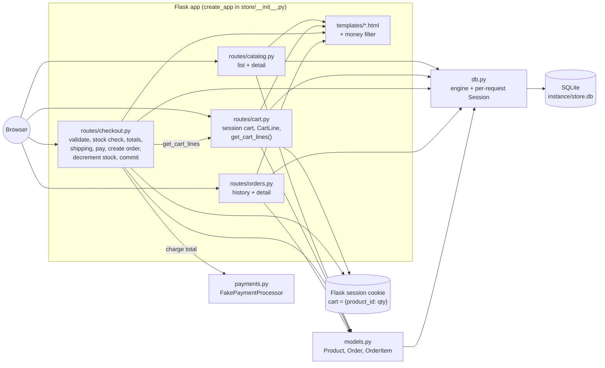

# Milestone 1 — Understand & Establish the Baseline

> **Understand before you redesign.**

## 1. Team & Store

- **Team members:**
  - Luis Rodríguez ([@luisdaa22](https://github.com/luisdaa22))
  - _Name_ ([@daneklu](https://github.com/daneklu))
  - Emmanuel Arias ([@yair91](https://github.com/yair91))
  - Ana Urrutia ([@anaaurrutiaa](https://github.com/anaaurrutiaa))
  - Lide González ([@lide8](https://github.com/lide8))
- **Store name:** Raíz Plant Shop
- **Store vertical / concept:** Online plant shop — easy-care houseplants plus pots and care tools.
- **Repository:** https://github.com/luisdaa22/Milestone-1-Understand-Establish-the-Baseline-
- **Short product description:** A small storefront where customers browse six products (four plants, a terracotta pot set and a watering can), add them to a session cart, pay with a simulated card token, and see their persisted order and order history.

## 2. Baseline Validation

- [x] Application runs from a clean setup (`pip install -e ".[dev]"` → `python reset_db.py` → `python seed.py` → `flask --app store run --debug`).
- [x] Existing automated tests pass locally: `python -m pytest` → **12 passed**.
- [x] GitHub Actions CI passes: [tests run on `m1-plant-shop-baseline`](https://github.com/luisdaa22/Milestone-1-Understand-Establish-the-Baseline-/actions/runs/43550968098) ✅
- [x] Catalog → cart → checkout → order flow works end-to-end.
- [x] Orders and inventory changes persist after restarting the app.

Evidence (run on Windows 11, Python 3.13, against the real seeded `src/instance/store.db`):

| Step | Result |
|---|---|
| Catalog `/` | Shows "Raíz Plant Shop" and all 6 seeded products |
| Add Monstera (PLANT-100), set qty 2, checkout with `tok_fail` | "Payment was declined", no order created |
| Same cart, checkout with `tok_success` | Redirect to confirmation page "Order #1" |
| **New Python process** reads the DB | `orders` row 1: Ana, subtotal 109800, shipping 9900, total 119700, `pay_946b5bf3d337`, `confirmed`; `order_items`: (PLANT-100, qty 2, 54900) |
| Same new process reads stock | Monstera stock **6** (seeded 8) |

A second teammate repeated the validation on macOS (Python 3.14) from a clean database:

| Step | Result |
|---|---|
| Tests | `python -m pytest -v` → **12 passed** |
| Cart: 2 × Monstera Deliciosa + 1 × Golden Pothos | Subtotal $1,327.00 |
| Checkout with `tok_fail` | "Payment was declined", no order created |
| Checkout with `tok_success` | **Order #1**: $1,327.00 + $99.00 shipping = **$1,426.00**, `confirmed` |
| Restart Flask, open `/orders` and `/` | Order #1 still listed; stock Monstera 8 → 6, Golden Pothos 20 → 19 |
| `src/instance/store.db` | `orders` row (132700 / 9900 / 142600 cents), two `order_items` rows with the unit price at purchase time |

**Defect fixed during validation:** `python reset_db.py` crashed on Windows with `PermissionError: [WinError 32]`. It calls `create_app()`, which opens a pooled SQLAlchemy connection to `store.db`, then tries to delete the file while it is still open. Fix: dispose the engine before unlinking (one line in `reset_db.py`). macOS/Linux allow deleting open files, which is why the starter didn't hit this.

**Defects found during the second validation:**

1. **Empty cart quantity returns HTTP 500.** In `/cart`, clearing the quantity field and pressing *Update* sends `quantity=""`; `int("")` raises `ValueError`. The browser's `type="number"` input does not prevent an empty value, so a normal user can hit this. Fixed in PR #2, with two regression tests.
2. **`scripts/verify.sh` does not reset the database.** It runs `rm -rf instance` in the project root, but Flask's instance folder is `src/instance/`, so the old `store.db` survives. It now calls `python reset_db.py`, which uses the path Flask actually resolves. Fixed in PR #3.

**Extra test coverage:** PR #4 adds 12 tests for baseline behaviour that was not tested yet (inactive products, cart edge cases, checkout validation and totals, order price snapshot and history order). The suite goes from 12 to 24 tests.

## 3. Current System Design

## 4. Responsibilities & Dependencies

| Part / module | Main responsibility | Important dependencies |
|---|---|---|
| `store/__init__.py` (`create_app`) | App factory: config (secret, DB path, store name), DB init, blueprint registration, `money` filter | Flask, `db.init_app`, all route blueprints |
| `db.py` | Create the SQLAlchemy engine, create tables, give each request one `Session` (stored in `g`) and close it on teardown | SQLAlchemy, Flask `g`/`current_app`, `models` (to register tables) |
| `models.py` | Persistent entities: `Product` (catalog + stock), `Order`, `OrderItem` (price/name/SKU snapshot) | `db.Base` |
| `routes/catalog.py` | List active products, show product detail (404 for missing/inactive) | `db`, `Product`, templates |
| `routes/cart.py` | Cart stored in the session cookie as `{product_id: qty}`; add/update/remove; builds `CartLine`s from DB products | Flask session, `db`, `Product` |
| `routes/checkout.py` | Coordinates the whole purchase: form validation, stock check, subtotal + fixed shipping, payment, order + item creation, stock decrement, commit, cart clear | `cart.get_cart_lines`, `FakePaymentProcessor`, `Order`, `OrderItem`, `db`, session |
| `routes/orders.py` | Order history (all orders, newest first) and order confirmation/detail | `db`, `Order` |
| `payments.py` | Simulated payment provider: returns a reference, raises `PaymentDeclined` for `tok_fail`/empty token | none (stdlib only) |
| `seed.py` / `reset_db.py` | Populate the catalog once / delete the dev DB | `create_app`, `Product` |

**Main purchase flow (`POST /checkout`):**

1. `place_order()` gets the request's DB session and calls `get_cart_lines()`, which reads `{id: qty}` from the session cookie and loads each active `Product`.
2. Empty cart → redirect to cart. Any missing form field → redirect back to the form.
3. For each line, if `quantity > product.stock_quantity` → flash "Not enough stock", redirect, nothing persisted.
4. Computes `subtotal` from current product prices and `total = subtotal + STANDARD_SHIPPING_CENTS` (99.00).
5. Calls `FakePaymentProcessor().charge(total, token)`. `PaymentDeclined` → flash and redirect, nothing persisted.
6. Creates the `Order` (status `confirmed`, payment reference), `flush()`es to get its id, appends one `OrderItem` per line (snapshotting SKU, name, unit price) and decrements each product's stock.
7. A single `db.commit()` persists order, items and stock changes together; then the session cart is cleared and the browser is redirected to `/orders/<id>`.

## 5. Design Observations

**O1 — Strength: money and order history are modelled correctly.**
All amounts are integer cents (`price_cents`, `total_cents`), so there is no floating-point rounding. `OrderItem` copies `sku`, `product_name` and `unit_price_cents` at purchase time, so a later price or name change does not rewrite past orders. Order, items and stock decrement are written in one `commit()`, so a failure before the commit leaves no half-created order.

**O2 — Reasonable original decision: the simple, concrete structure fits the current requirements.**
One blueprint per page area, a session-cookie cart, SQLite with `create_all` instead of migrations, a fake payment class, and a single fixed shipping constant. With one shipping option, one payment provider and no user accounts, this is the least design that works, and it is easy to test: `create_app(test_config)` lets every test run against its own temporary database (`tests/conftest.py`). We see no reason to add layers or interfaces now.

**O3 — Coupling / design pressure: checkout holds all purchase coordination knowledge.**
`place_order()` in `routes/checkout.py` mixes HTTP concerns (form parsing, flash, redirects) with business rules (stock rule, total = subtotal + shipping, when to charge, order status, inventory decrement) and persistence. It also *constructs* `FakePaymentProcessor()` itself and reads the module constant `STANDARD_SHIPPING_CENTS`. The subtotal formula is repeated in three places (`cart.view_cart`, `checkout.checkout_form`, `checkout.place_order`).
*Now:* this is one readable 80-line function and acceptable. *Only if* new requirements arrive (e.g. several shipping methods, a real/second payment provider, discounts, taxes), these rules would have to change inside the route, and the duplicated subtotal could drift. That is where we would consider extracting checkout logic — not before.

**O4 — Technical debt: payment happens outside the database transaction, and the stock check is not atomic.**
The card is charged (step 5) *before* the order is committed (step 7). If the commit fails (DB error, constraint, crash), the customer has been charged with no order and nothing records or refunds the payment. Separately, stock is checked and then decremented in Python with no row lock or conditional update, so two concurrent checkouts for the last unit can both pass the check and drive stock negative. Both are harmless with a fake provider and a single local user, but become real defects with a real payment provider or concurrent traffic.

**O5 — Technical debt: weak input handling at the edges.**
`cart.update` does `int(request.form.get("quantity"))` with no error handling: posting `quantity=abc` returns **HTTP 500** (verified). The browser's `type="number"` input blocks letters but not an empty field, so clearing the quantity and pressing *Update* also returns 500. That part is a real, user-visible defect (see section 2, fixed in PR #2). Also, the cart lets a quantity exceed stock until checkout, and `/orders` lists *every* customer's orders because there are no accounts — fine for a demo, but a privacy problem once real customers exist.

## 6. AI Use

- **Tool:** Claude Code (Anthropic), used in VS Code.
- **What it helped with:** reading the starter code and summarising responsibilities; drafting the Mermaid diagram and design observations; generating the plant catalog text and SVG product images; running the baseline verification script against the real SQLite database; diagnosing the Windows `reset_db.py` `PermissionError` and proposing the one-line fix.
- **Also used:** Claude (Anthropic) to repeat the end-to-end validation on macOS, spot the empty-quantity and `verify.sh` defects, and assemble the evidence PDF.
- **What the team reviewed / validated:**
  - Chose the store concept, products and prices.
  - Re-ran the tests and the purchase flow (`tok_success` and `tok_fail`) in the browser on our own machines, and the restart check for orders and stock.
  - Checked each observation against the code and confirmed the diagram matches the imports in `routes/`.
  - Reproduced the Windows `reset_db.py` error before accepting the fix.
  - Decided not to redesign anything in M1 beyond the defect fix.
